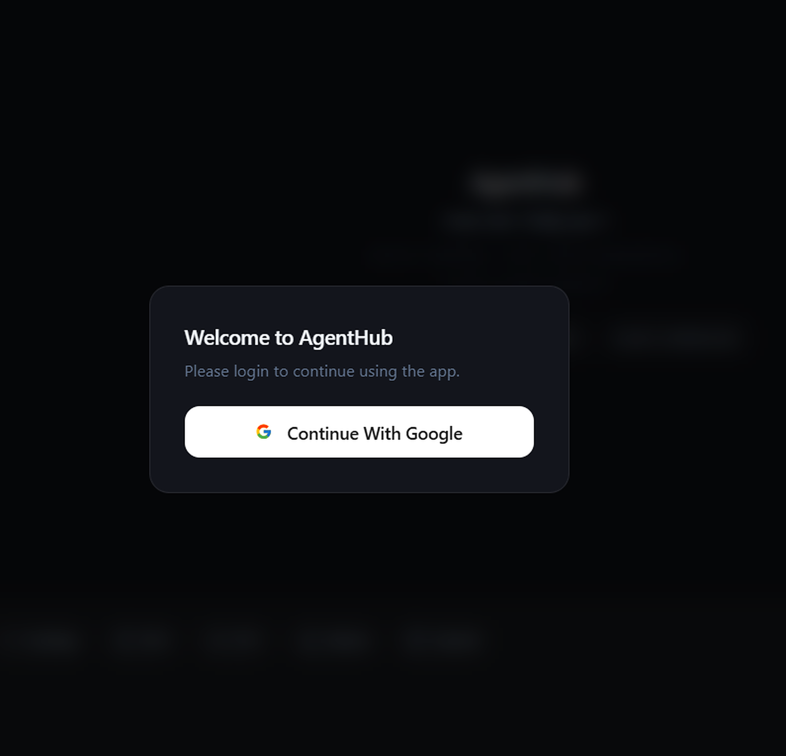
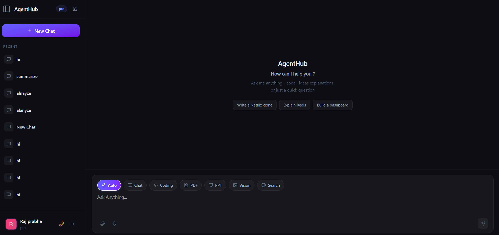
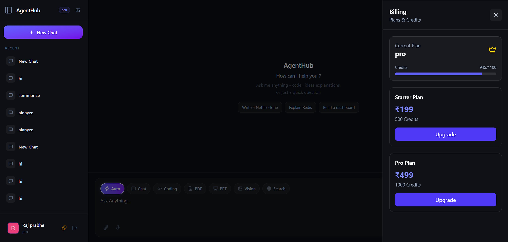
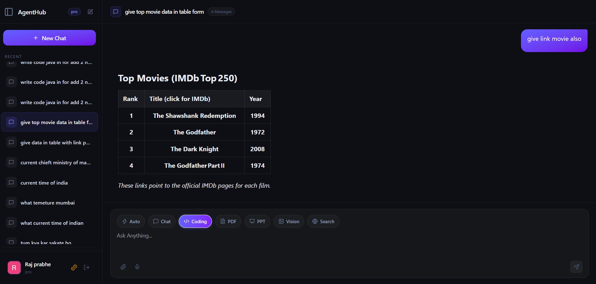
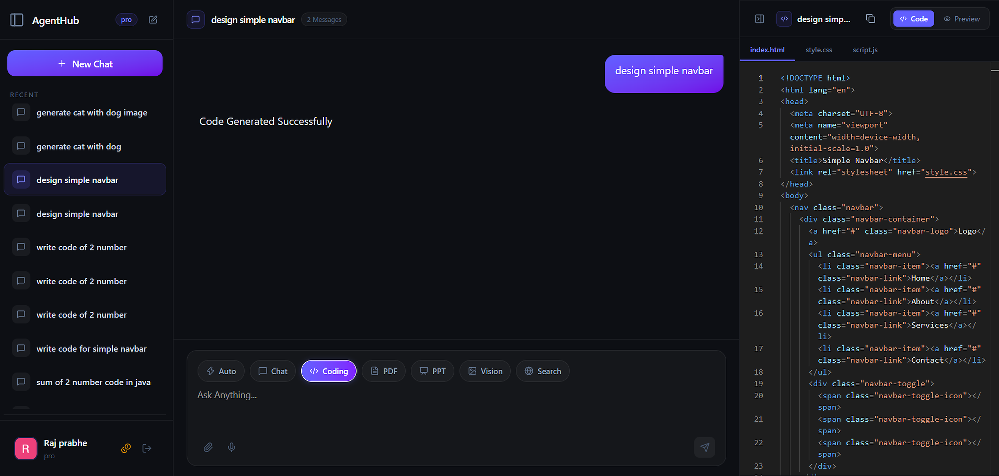
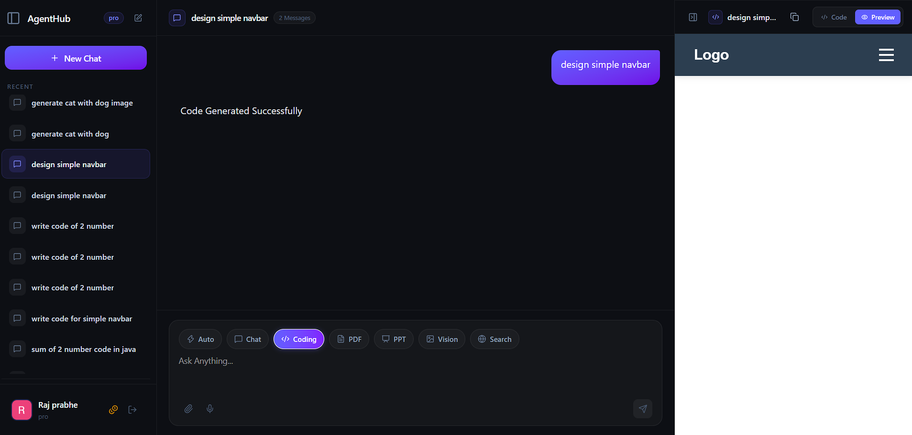
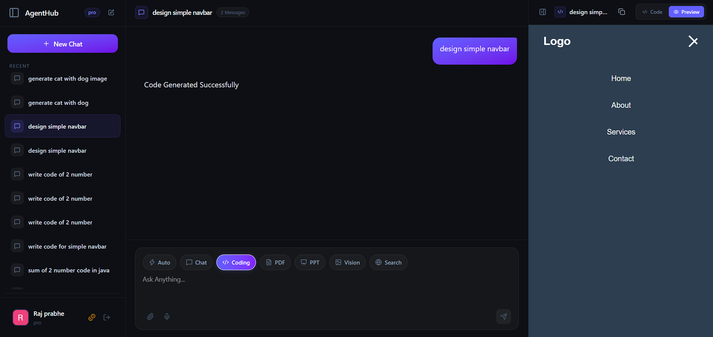
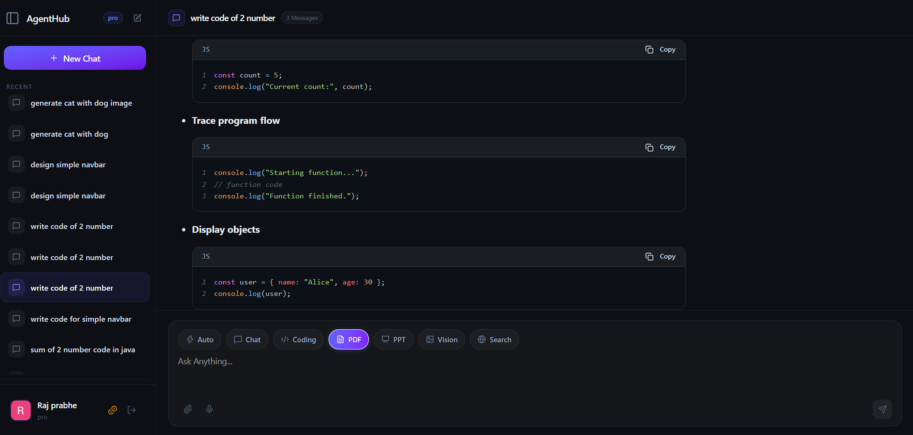
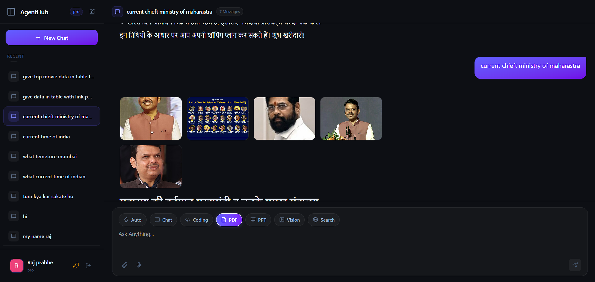

# AgentHub

AgentHub is a full-stack AI agent platform that enables users to interact with AI, generate code and images, create documents, and preview generated code through a unified chat interface. It features Google authentication, conversation history, a credit-based billing system with Razorpay integration, and cloud file storage using AWS S3. Built with React, Vite, Node.js, Express.js, MongoDB, Redis, and AI model integrations, AgentHub uses a service-based backend architecture to manage authentication, conversations, and AI-powered workflows.


## Authors

- [@Raj Prabhe](https://github.com/rajprabhe)


## Installation

Install AgentHub with npm

```bash
  git clone https://github.com/rajprabhe/AgentHub.git
  cd AgentHub
  npm run install-all
```

## Run the Project
```bash
  docker compose up -d
```

```bash
  npm run dev
```


    
## Environment Variables 

Create a `.env` file in each service directory using the following examples.

### Frontend — `frontend/.env.example`

```env
VITE_FIREBASE_API_KEY="your_firebase_api_key"
VITE_SERVER_URL="http://localhost:8000"
VITE_RAZORPAY_KEY_ID="your_razorpay_key_id"
```

### Gateway — `backend/gateway/.env.example`

```env
PORT=8000
AUTH_SERVICE=http://localhost:8001
CHAT_SERVICE=http://localhost:8002
AGENT_SERVICE=http://localhost:8003
BILLING_SERVICE=http://localhost:8004
FRONTEND_URL=http://localhost:5173
REDIS_URL=redis://localhost:6379
```

### Auth Service — `backend/services/auth/.env.example`

```env
PORT=8001
MONGODB_URI="your_mongodb_uri"
REDIS_URL=redis://localhost:6379
```

### Chat Service — `backend/services/chat/.env.example`

```env
PORT=8002
MONGODB_URI="your_mongodb_uri"
```

### Agent Service — `backend/services/agent/.env.example`

```env
PORT=8003
MONGODB_URI="your_mongodb_uri"

GROQ_API_KEY="your_groq_api_key"
TAVILY_API_KEY="your_tavily_api_key"
GOOGLE_API_KEY="your_google_api_key"
OPENROUTER_API_KEY="your_openrouter_api_key"

CHAT_SERVICE=http://localhost:8002
AUTH_SERVICE=http://localhost:8001
REDIS_URL=redis://localhost:6379

AWS_ACCESS_KEY_ID="your_aws_access_key_id"
AWS_SECRET_KEY_ID="your_aws_secret_access_key"
AWS_BUCKET_NAME="your_s3_bucket_name"

QDRANT_API_KEY="your_qdrant_api_key"
QDRANT_URL="your_qdrant_url"
```

### Billing Service — `backend/services/billing/.env.example`

```env
PORT=8004
MONGODB_URI="your_mongodb_uri"
RAZORPAY_KEY_ID="your_razorpay_key_id"
RAZORPAY_KEY_SECRET="your_razorpay_key_secret"
AUTH_SERVICE=http://localhost:8001
```

## Setup Instructions

1. Create the relevant `.env` files by copying the corresponding `.env.example` files.
2. Replace placeholder values with your actual credentials.
3. Ensure MongoDB and Redis are running and accessible.
4. Configure Firebase, AI providers, AWS S3, Qdrant, and Razorpay as required.
5. Start the application from the root directory:

```bash
npm run dev
```


## Tech Stack

- **Frontend:** React.js, Vite, Redux
- **Backend:** Node.js, Express.js
- **Architecture:** Microservices-based architecture with an API Gateway
- **Authentication:** Firebase Authentication, Firebase Admin SDK
- **Database:** MongoDB
- **Caching & Session Management:** Redis
- **AI Integration:** LangChain, LangGraph, Groq, Google Gemini, OpenRouter
- **AI Search:** Tavily
- **Vector Database:** Qdrant
- **File Storage:** AWS S3
- **Payment Gateway:** Razorpay
- **Environment Configuration:** dotenv
- **Development Tools:** Git, GitHub, npm


## Features

- AI-powered chat with specialized agents
- AI code generation with live previews
- AI image generation
- PDF and PowerPoint generation
- Code editor with artifact preview
- Conversation history and management
- Google authentication with Firebase
- Credit-based billing system
- Razorpay payment integration
- Cloud file storage with AWS S3
- Multiple AI model integrations
- Microservices-based backend architecture


## Screenshots











